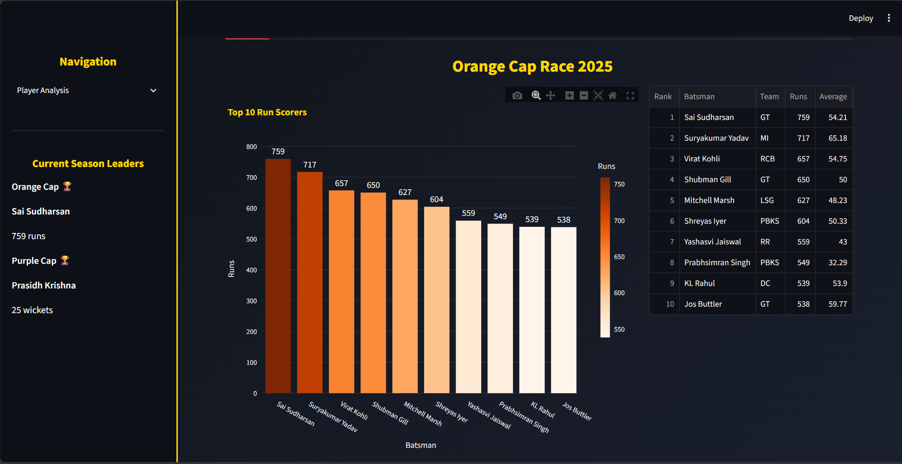

# IPL 2025 Analytics Dashboard

An interactive dashboard for exploring IPL 2025 player and team performance, built with **Streamlit, Pandas and Plotly**.



## Features

**Player Analysis**
- Orange Cap and Purple Cap races (top 10 charts and tables)
- Best batsman and best bowler, picked by a weighted score with an adjustable minimum-runs / minimum-wickets filter
- Top all-rounders (needs the optional all-rounders file)

**Team Analysis**
- Wins leaderboard
- Squad deep dive: squad size, average age, country mix
- Auction spending by team and by player role

**Ground Analysis**
- Most-used venues, toss decision split, how often the toss winner also won
- Wins by team at a selected venue
- Needs a venue column in `matches.csv`. If there isn't one, the page lists the columns it found.

## How "best player" is decided

Each stat is scaled to 0-1 among players who pass the minimum filter, then combined using weights.
The weights are my own judgement, not an official formula. They are defined at the top of
`ipl_dashboard.py` (`BAT_WEIGHTS`, `BOWL_WEIGHTS`) and are easy to change. For bowlers, lower economy scores higher.
The qualification filter stops a player with very few runs or wickets from winning on average or economy alone.

## Run it locally

```bash
git clone https://github.com/<your-username>/<your-repo>.git
cd <your-repo>
pip install -r requirements.txt
streamlit run ipl_dashboard.py
```

## Data

Put the CSV files in a `data/` folder or next to `ipl_dashboard.py`.

| File | Required | Columns used | Purpose |
|------|----------|--------------|---------|
| `orange_cap.csv` | Yes | Batsman, Team, Runs, Average, Strike_rate, Sixes, Fours | Batting leaders |
| `purple_cap.csv` | Yes | Bowler, Team, Wickets, Economy_rate, Maidens | Bowling leaders |
| `matches.csv` | Yes | match_winner (optional: venue, toss_winner, toss_decision) | Wins, venues, toss |
| `player_info.csv` | Yes | TEAM, AGE, COUNTRY, SOLD_PRICE | Squads and auction prices |
| `ipl_2025_allrounders.csv` | Optional | Player Name, Runs Scored, Wickets Taken, Batting Average, Eco Rate | All-rounders tab |

`deliveries.csv` and `cricket_data_2025.csv` are included for future ball-by-ball analysis and are not used by the dashboard yet.

**Data source:** <dataset name and link, e.g. Kaggle>

## Limitations

- Descriptive analytics only. There is no predictive model.
- Best-player scores depend on hand-picked weights.
- Auction prices are parsed from text such as "1.5 Cr" or "50 Lakh". Values in other formats show as missing.

## Possible next steps

- Use ball-by-ball data for powerplay and death-over analysis
- Add a prediction model (for example, next-season runs or match outcome)
- Deploy on Streamlit Community Cloud
